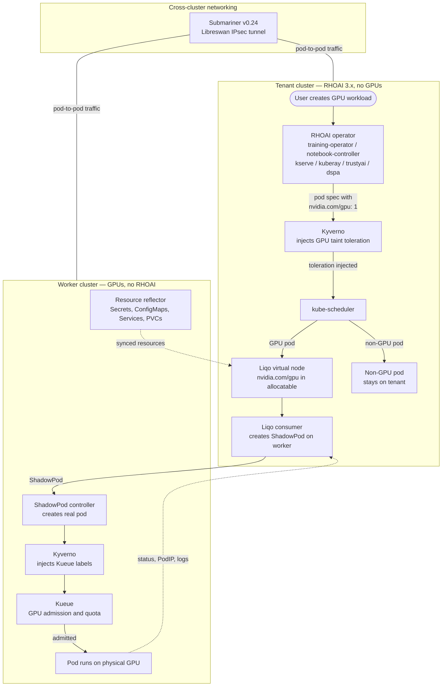

# Architecture

## The idea

A tenant cluster runs RHOAI 3.x with all the operators but has no GPUs.
A separate worker cluster has the physical GPUs but no RHOAI. Users
interact with RHOAI on the tenant exactly as they normally would. When
they request a GPU, the workload runs on the worker's hardware. When
they don't, the workload stays on the tenant. The user does not know
which cluster runs the pod.



How the pieces fit together:

- The tenant cluster owns all RHOAI operators and CRDs. Users create
  Notebooks, PyTorchJobs, InferenceServices, and pipelines here. The
  worker has no RHOAI at all.
- Liqo peers the two clusters and registers a virtual node on the
  tenant. This node advertises `nvidia.com/gpu` in its allocatable
  resources. No other node on the tenant has GPUs, so the kube-scheduler
  places GPU pods on the virtual node automatically.
- Kyverno on the tenant injects a GPU taint toleration into pods that
  request `nvidia.com/gpu`. This is what makes only GPU pods land on
  the virtual node. Non-GPU pods (DSPA, LMEval, monitoring) stay local.
- When a pod lands on the virtual node, Liqo's consumer controller
  creates a ShadowPod CRD on the worker. The ShadowPod controller on
  the worker turns it into a real pod.
- Kyverno on the worker injects Kueue scheduling labels into incoming
  pods. Kueue checks the ClusterQueue: if a GPU is available, the pod
  runs. If not, it queues until one frees up. Priority preemption works
  through Kueue's standard mechanisms.
- Liqo's resource reflector syncs Secrets, ConfigMaps, Services, and
  PVCs from the tenant namespace to a twin namespace on the worker, so
  the offloaded pod has everything it needs.
- Status, logs, and the real worker PodIP sync back to the tenant
  automatically. From the user's perspective, the pod looks like it
  runs on the tenant.
- Submariner provides the actual network path. Liqo's built-in
  WireGuard networking does not work on OpenShift (SCC/privilege
  conflicts), so we disable it and use Submariner's Libreswan IPsec
  tunnels instead. This is what makes interactive workloads possible:
  Jupyter notebooks, KServe inference, and distributed training all
  need pod-to-pod connectivity across clusters.
- The namespace on the tenant is offloaded with Liqo's `LocalAndRemote`
  strategy. Liqo creates a twin namespace on the worker with the same
  name (`EnforceSameName` for single-tenant, `DefaultName` with a
  cluster prefix for multi-tenant). Reflected resources and ShadowPods
  land in the twin namespace.


## Lab topology

```
┌──────────────────────────┐              ┌──────────────────────────┐
│  sno-tenant-rhoai3       │              │  sno-worker              │
│  OCP 4.19, RHOAI 3.x     │              │  OCP 4.22, RTX 5090      │
│                          │              │  GPU Operator, Kueue      │
│  ┌────────────────────┐  │              │                          │
│  │ Liqo control plane │  │              │  ┌────────────────────┐  │
│  │ (consumer mode)    │  │   Liqo       │  │ Liqo control plane │  │
│  │ - VK controller    │  │   peering    │  │ (provider mode)    │  │
│  │ - resource reflector◄─┼──────────────┼──► - ShadowPod ctrl   │  │
│  │ - storage fabric   │  │              │  │ - auth module      │  │
│  └────────────────────┘  │              │  └────────────────────┘  │
│                          │              │                          │
│  ┌────────────────────┐  │   Submariner │  ┌────────────────────┐  │
│  │ Submariner gateway │◄─┼──────────────┼──► Submariner gateway │  │
│  │ (cross-cluster net)│  │   IPsec      │  │                    │  │
│  └────────────────────┘  │   tunnel     │  └────────────────────┘  │
└──────────────────────────┘              └──────────────────────────┘
```

Two separate concerns, two separate layers:

- **Liqo** handles pod offloading, status sync, and resource reflection
  (Secrets, ConfigMaps, ServiceAccounts, Services, PVCs).
- **Submariner** handles cross-cluster networking via Libreswan IPsec
  tunnels. Liqo's own WireGuard networking is disabled because it does
  not work on OpenShift (SCC/privilege issues).


## Dispatch flow: custom VK vs Liqo

**Custom VK** -- explicit scheduling, custom sync code:

1. User creates pod with `nodeName: gpu-worker` + VK tolerations
2. Custom VK binary intercepts pod, calls worker API directly
3. Custom ResourceSyncer + DepReconciler sync Secrets/ConfigMaps
4. Custom code syncs pod status back to tenant

**Liqo** -- resource-based scheduling, built-in reflection:

1. Namespace `vk-test` is offloaded with `LocalAndRemote` strategy
2. User creates pod in `vk-test` with **no special scheduling** -- no
   `nodeName`, no tolerations, no annotations
3. Liqo's mutating webhook adds tolerations for the virtual node taint
   but does **not** set `nodeName` -- the kube-scheduler decides
4. GPU pods are placed on the virtual node `gpu-worker` (the only node
   with `nvidia.com/gpu` in allocatable). Non-GPU pods stay on local
   nodes (scheduler scores them higher due to more CPU/memory)
5. Liqo creates a **ShadowPod CRD** on the worker in the twin namespace
   (`vk-test`, same name via `EnforceSameName` strategy)
6. ShadowPod controller on the worker creates the actual Pod
7. Liqo resource reflection automatically syncs Secrets, ConfigMaps,
   ServiceAccounts, and Services referenced by the pod
8. Liqo syncs pod status (phase, exit code, PodIP) back to the tenant

The key advantage: RHOAI operators (training operator, KServe) create
pods normally in the offloaded namespace. They don't need any
VK-specific scheduling logic -- pods requesting GPUs are automatically
placed on the virtual node by the scheduler. Non-GPU pods in the same
namespace stay local. This is what tests L9 (PyTorchJob) and L10
(KServe) validate.

**Why `LocalAndRemote` instead of `Remote`:** With `Remote`, ALL pods
in the namespace go to the GPU worker, including non-GPU workloads
like Apache, monitoring sidecars, or debug pods. This wastes GPU
cluster resources and prevents mixed-workload namespaces. With
`LocalAndRemote`, the scheduler makes resource-aware placement
decisions: GPU pods go remote, non-GPU pods stay local. All 17 tests
pass with both strategies.

**Production hardening for non-GPU pod placement (validated):** With
`LocalAndRemote`, the Liqo webhook adds virtual node tolerations to
ALL pods in the namespace. The scheduler may place non-GPU pods on
the virtual node if its resource scoring is favorable. Adding a
`nvidia.com/gpu=present:NoSchedule` taint to the virtual node and a
Kyverno ClusterPolicy on the tenant to inject the matching toleration
only for pods requesting `nvidia.com/gpu` guarantees deterministic
placement. All 17 tests pass with this configuration. RHOAI operators
(training operator, KServe) do NOT strip Kyverno-injected tolerations
during pod reconciliation. See
[GPU taint + Kyverno toleration injection](liqo-spike-assessment.md#gpu-taint--kyverno-toleration-injection-on-tenant)
in the spike assessment for the exact setup.


## Design decision: Submariner over Liqo networking

### Why Liqo's WireGuard module is incompatible with OpenShift

Liqo's networking module has three layers, all requiring elevated
privileges that conflict with OpenShift's SecurityContextConstraints:

1. **WireGuard gateway pods** (one per peering) -- require `privileged`
   containers with `hostNetwork: true`, capabilities `NET_ADMIN`,
   `NET_RAW`, `SYS_ADMIN`, `allowPrivilegeEscalation: true`, and
   `RunAsAny` for UID/fsGroup/SELinux. The gateway creates WireGuard
   interfaces, manipulates routing tables, and configures nftables NAT
   rules for IP remapping.

2. **Fabric DaemonSet** (every physical node) -- creates Geneve overlay
   tunnels from all nodes to all gateways, requires `NET_ADMIN` to
   manage network interfaces and routing, plus nftables access
   (kernel 5.10+ hard requirement).

3. **IPAM controller** -- handles PodCIDR remapping so pods across
   clusters can communicate even with overlapping CIDRs. The gateway
   configures nftables NAT rules for transparent address translation.

OpenShift's default `restricted` SCC blocks all of these: no privileged
containers, no host networking, no `NET_ADMIN`/`NET_RAW`/`SYS_ADMIN`,
no privilege escalation, no `RunAsAny`. Liqo's Helm chart ships custom
SCC templates (`liqo-scc.yaml`, `liqo-gateway-scc.yaml`) to create the
required SCCs, but in v1.2.0 the gateway SCC template has a rendering
bug ([Issue #3385](https://github.com/liqotech/liqo/issues/3385)) where
`.` is passed to the label helper without the required `.name`/`.module`
fields, producing invalid labels like
`app.kubernetes.io/instance: "liqo-%!s(<nil>)"`. This blocks
`liqoctl install openshift` in Helm's atomic mode.

Even if the SCC templates are fixed manually, the gateway needs the full
`privileged` SCC equivalent, the most permissive SCC in OpenShift.
There is no per-component privilege scoping, no userspace WireGuard
fallback, and no IPsec alternative. The Liqo compatibility matrix was
last tested on OCP 4.8, and there is no ROSA/ARO support (managed
OpenShift forbids manipulating system SCCs).

### Why Submariner works on OpenShift

Submariner also requires privileged access for its gateway and
routeagent, but works on OpenShift because:

1. **Red Hat is a primary maintainer.** Submariner is integrated into
   RHACM via `submariner-addon`. OpenShift-specific issues are caught
   and fixed as part of Red Hat's product lifecycle.

2. **Proper SCC management.** Since v0.14, Submariner creates dedicated
   ClusterRole/ClusterRoleBinding resources instead of modifying the
   system `privileged` SCC (which is forbidden on ROSA/ARO). Each
   component (`submariner-gateway`, `submariner-routeagent`,
   `submariner-globalnet`, `submariner-lighthouse-coredns`) has its
   own service account with scoped privileges.

3. **Libreswan IPsec by default.** Submariner uses Libreswan (not
   WireGuard), which does not require a WireGuard kernel module. It
   creates 4 IPsec tunnels (pod-to-pod, pod-to-service, service-to-pod,
   service-to-service). WireGuard is available as an alternative but
   requires pre-installation on gateway nodes.

4. **OpenShift network plugin detection.** Submariner auto-discovers the
   CNI plugin (OpenShiftSDN, OVN-Kubernetes), Service CIDRs, and
   Cluster CIDRs. Supports OVN-Kubernetes IPsec on OCP 4.12+.

5. **Tested and supported.** Submariner is part of Red Hat's supported
   product stack. Liqo is an academic/community project (Politecnico di
   Torino) without Red Hat engineering support.

### How the split architecture works

We run Liqo with `networking.enabled=false` and
`offloading.disableNetworkCheck=true`, disabling all three networking
layers (WireGuard, Geneve fabric, IPAM). This means:

- **No IP remapping** -- Liqo syncs the real worker PodIP (e.g.,
  `10.132.x.x`) to the tenant pod status without NAT translation
- **No Liqo tunnels** -- no WireGuard interfaces, no Geneve overlay, no
  nftables rules from Liqo
- **Submariner handles all cross-cluster traffic** -- Libreswan IPsec
  tunnels carry pod-to-pod and service-to-pod traffic between clusters

The critical enabler: when networking is disabled, Liqo syncs the
**real worker PodIP** to the tenant pod status. Submariner's routeagent
sees this PodIP in EndpointSlices and routes traffic through the IPsec
tunnel. If Liqo's networking were enabled, it would remap PodIPs,
breaking Submariner's routing.

Test L3 validates PodIP sync (tenant pod shows worker CIDR IP), and
test L13 validates end-to-end Service reachability through Submariner.

| Concern | Handled by | Component |
|---------|-----------|-----------|
| Pod offloading | Liqo | ShadowPod controller |
| Status sync (phase, PodIP) | Liqo | VK controller |
| Resource reflection (Secrets, ConfigMaps, Services) | Liqo | Resource reflector |
| Storage (PVC) | Liqo | Storage fabric |
| Cross-cluster networking | Submariner | Libreswan IPsec gateway |
| Service discovery | Submariner | Lighthouse CoreDNS |
| DNS for headless Services | Liqo (reflection) + Submariner (routing) | Both |

One side effect: Submariner's routeagent DaemonSet tries to schedule on
the Liqo virtual node and gets `OffloadingBackOff`. Harmless but noisy.
Suppress with a node anti-affinity on `liqo.io/type=virtual-node`.

### Risks of the split architecture

The Liqo-offloading + Submariner-networking split is the right call
given OpenShift's constraints, but carries risks that should be tracked:

1. **PodIP sync is an undocumented behavior.** The entire architecture
   depends on Liqo syncing the real worker PodIP to the tenant pod
   status when networking is disabled. This is not a documented API
   contract, it is implementation behavior we discovered through
   testing (L3). A Liqo upgrade could introduce IP remapping even with
   networking disabled, silently breaking Submariner routing. This
   behavior should be verified on every Liqo version bump, and L3 + L13
   should be the first tests run after any upgrade.

2. **Two control planes for networking.** Liqo handles Service/
   EndpointSlice reflection, Submariner handles tunnel routing. When a
   cross-cluster service call fails, debugging spans both systems:
   Liqo reflection (is the Service reflected? is the EndpointSlice
   correct? does it have the real PodIP?) and Submariner routing (is
   the tunnel up? is the routeagent forwarding? is Lighthouse DNS
   resolving?). This is more operational complexity than either system
   alone.

3. **PodCIDR overlap is not handled without Globalnet.** Liqo's IPAM
   (disabled) would normally remap overlapping PodCIDRs with nftables
   NAT. Without it, tenant and worker clusters **must have
   non-overlapping Pod and Service CIDRs**. In the lab each cluster has
   manually allocated ranges (10.128.0.0/14, 10.132.0.0/14,
   10.136.0.0/14, 10.140.0.0/14), so this is not an issue today.
   In production with many tenants, CIDR planning becomes a hard
   constraint.

   **Current Submariner networking:** Globalnet is NOT enabled in this
   deployment (`global_cidr: []`). Submariner uses `243.0.0.0/20`
   (Class E experimental range) for ClustersetIP services (cross-cluster
   service discovery), and routes pod-to-pod traffic using real PodIPs
   directly through the IPsec tunnel. This requires non-overlapping
   CIDRs.

   **Risk for GPUaaS:** Low today. We control tenant cluster
   provisioning and assign CIDRs at install time. Each cluster gets a
   /14 (262k IPs). With the 10.0.0.0/8 private space, we can fit ~64
   non-overlapping /14 ranges before exhaustion. For the current lab
   and early production this is plenty. The risk emerges at scale: 100+
   tenants would force either smaller per-cluster ranges (fewer pods)
   or Globalnet. If GPUaaS ever onboards externally managed clusters
   where we don't control CIDR allocation, Globalnet becomes mandatory
   regardless of scale.

   **Mitigation: Submariner Globalnet with CGNAT.** Globalnet can be
   enabled to act as CGNAT (Carrier-Grade NAT, RFC 6598) for
   Kubernetes. It assigns virtual GlobalIPs from a configurable range.
   Using the CGNAT block `100.64.0.0/10` is a natural fit since it
   is reserved for shared address space and won't conflict with
   RFC 1918 ranges used by cluster PodCIDRs. Globalnet NATs traffic
   at the Submariner gateway, so clusters can have fully overlapping
   PodCIDRs. Trade-offs: extra NAT hop at the gateway (latency),
   the CGNAT range must be sized for all expected pods across all
   clusters (100.64.0.0/10 provides ~4M addresses), and cross-cluster
   traffic uses translated IPs (debugging is harder). However, it
   eliminates the CIDR planning constraint entirely. Globalnet was not
   tested in this spike but is a standard Submariner feature with
   Red Hat support.

4. **Liqo IPAM can black-hole infrastructure traffic, validated by
   incident.** A parallel spike on IBM Cloud VPC experienced a critical
   incident that validates our decision to disable Liqo networking.
   When peering a tenant cluster (pod CIDR `10.128.0.0/14`) with the
   GPU worker (pod CIDR `10.132.0.0/14`), Liqo's IPAM did not remap
   the remote CIDR because it didn't directly overlap with the local
   one. However, `10.128.0.0/14` covers `10.128.0.0`-`10.131.255.255`,
   which includes the IBM Cloud VPC DNS resolvers at `10.130.64.x`.

   The `liqo-fabric` DaemonSet programmed routes on every node for the
   remote pod CIDR (`10.128.0.0/14`) pointing at a gateway tunnel in
   `ConnectionMissing` state. All DNS traffic to `10.130.64.4`,
   `10.130.64.70`, and `10.130.64.134` was black-holed, sent to the
   dead tunnel instead of the VPC network. CoreDNS pods could not
   reach upstream resolvers, cascading into failures across the cluster:
   etcd (1/3 members), authentication, console, ingress, storage
   (IBM VPC CSI couldn't resolve `iam.cloud.ibm.com`), and
   kube-controller-manager (`cluster-policy-controller` couldn't reach
   the API, so new namespaces lacked default ServiceAccounts and SCCs).

   **The cluster was degraded for 5 days.** Resolution required deleting
   the ForeignCluster and all Liqo networking resources to remove the
   bad routes, then rebooting `master-0`. Liqo's upstream behavior of
   programming routes even when the gateway connection is down is a
   design concern: a broken gateway should withdraw routes, not keep
   them.

   **Relevance to us:** Our CIDRs don't overlap with infrastructure
   ranges because we control the bare-metal lab. But with networking
   disabled, the IPAM never runs and this class of bug is impossible.
   If we ever re-evaluate Liqo networking, `reservedSubnets` must
   cover the entire `10.0.0.0/8` range to prevent route conflicts with
   infrastructure networks.

5. **Liqo upstream may fix OpenShift networking.** If Liqo ships
   working SCC templates and reduces privilege requirements in a future
   version, the split architecture becomes unnecessary overhead. The
   gateway SCC bug ([#3385](https://github.com/liqotech/liqo/issues/3385))
   is a one-line fix. The deeper issue is the `privileged` SCC
   requirement, which is architectural and unlikely to change soon.
   Monitor upstream but don't wait for it.

6. **Submariner version coupling.** Submariner must be compatible with
   both clusters' OCP versions and CNI plugins. When upgrading either
   cluster, Submariner compatibility must be checked. This is mitigated
   by Submariner being part of RHACM with a formal support matrix, but
   it is an additional upgrade dependency.

**Why the split is still the right call:**

- The alternative (fighting Liqo's WireGuard on OpenShift) means
  patching SCC templates, granting `privileged` SCC to Liqo gateway
  pods, and depending on an untested (on OCP 4.19+) networking stack
  with no Red Hat support. If it breaks, there is no one to call.
- Submariner is Red Hat maintained, part of RHACM, with proper SCC
  management since v0.14 and a formal OpenShift support matrix.
- The split gives us clean separation of concerns: Liqo does what it
  does well (offloading, reflection, storage), Submariner does what it
  does well (cross-cluster L3 networking with IPsec).


## PVC model

Liqo creates a virtual StorageClass called `liqo` on the tenant cluster.
PVCs use `storageClassName: liqo`, and Liqo reflects them to the worker
with the real StorageClass (`lvms-vg1`), configured at peering time via
`--remote-real-storage-class-name=lvms-vg1`. Actual storage is
provisioned on the worker only.

The remapping is provider-agnostic. The tenant always uses
`storageClassName: liqo`, and Liqo remaps to the worker's default SC:
`lvms-vg1` on bare metal, `gp3` on AWS, `pd-ssd` on GCP, etc. The
`liqo.io/remote-storage-class` annotation exists for explicit SC
targeting when the default is not appropriate. The tenant does not need
to know the worker's storage backend.

Unlike the custom VK's Catapult model (which gates PVC creation via an
opt-in StorageClass), Liqo reflects all PVCs in the namespace.
There is no rejection mechanism for PVCs that should stay local.

**Important:** Do not set `liqo` as the default StorageClass on the
tenant. Infrastructure components that stay local (DSPA, monitoring,
dashboard) would get PVCs provisioned on the worker, causing mount
failures. Keep the cloud provider's SC as default and use `liqo`
explicitly for GPU workload storage.


## Setup sequence

The playbook (`playbooks/04-setup-liqo.yml`) runs eight steps:

1. **Install liqoctl** v1.2.0 binary
2. **Install Liqo on worker** (provider mode) -- networking disabled,
   storage enabled, `--disable-kernel-version-check` (not needed since
   networking is off)
3. **Install Liqo on tenant** (consumer mode) -- same flags
4. **Peer clusters** -- `liqoctl peer` with `--networking-disabled` and
   `--resource nvidia.com/gpu=1` to advertise 1 GPU on the virtual node
5. **Verify virtual node** -- wait for `liqo.io/type=virtual-node` node
   with GPU in allocatable and Ready condition
6. **Create and offload namespace** -- `vk-test` with `LocalAndRemote`
   strategy and `EnforceSameName` mapping (scheduler-driven GPU
   placement)
7. **Taint virtual node** -- `nvidia.com/gpu=present:NoSchedule` for
   deterministic placement (non-GPU pods stay local)
8. **Install Kyverno + GPU toleration policy** -- Kyverno on the tenant
   cluster with `deploy/tenant-gpu-toleration-policy.yml` to inject
   both tolerations into GPU pods (see
   [GPU taint + Kyverno](liqo-spike-assessment.md#gpu-taint--kyverno-toleration-injection-on-tenant))


## Architecture comparison table

| Aspect | Custom VK | Liqo |
|--------|-----------|------|
| Scheduling model | Explicit (`nodeName` + tolerations) | Resource-based (scheduler places GPU pods on virtual node) |
| Worker footprint | SA + RBAC only | Full Liqo control plane (ShadowPod controller, auth) |
| Pod creation | Direct Pod via worker API | ShadowPod CRD, controller creates Pod |
| PVC model | Opt-in (`storageClassName: catapult`) | Virtual StorageClass (`liqo`) with remote remapping |
| Resource sync | Custom Go code (ResourceSyncer + DepReconciler) | Built-in resource reflection |
| RHOAI transparency | Needs `nodeName`/tolerations on workload spec | Fully transparent, GPU requests drive placement, no workload changes |
| Maintenance | Custom Go binary (us) | Upstream open-source project (liqotech) |
| Multi-tenant isolation | Auto-generated namespace prefix (`vk-{hash}-{ns}`) | Twin namespaces per peering (same or custom name) |
